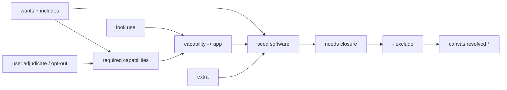

# nix-canvas

[](https://github.com/theferrer/nix-canvas/actions/workflows/ci.yml)
[](./LICENSE)

A host declares what it is and what it wants; canvas resolves that into a
software set. The apps themselves live in a separate module (a *palette*),
so a host never lists packages:

```nix
canvas = {
  machine = { primaryUser = "alice"; formFactor = "laptop"; };
  wants   = [ "desktop" "development" ];
  look    = "someones-hyprland";
  use     = { terminal = "kitty"; };
};
```

A palette supplies the vocabulary: which software exists, which capabilities
it provides, what the `desktop` want means. Canvas has no built-in knowledge
of concrete applications. The resolver turns intent plus catalog into
`canvas.resolved.*`: the active software set, a capability→app map, derived
facts (`graphical`, `sessionProtocol`), and provenance for every name:

```bash
$ nix eval .#nixosConfigurations.zeph.config.canvas.resolved.provenance.ripgrep
[ "want:cli-core" ]
```

Capability names are the canvas-owned spec that makes hosts portable across
palettes; want and look names belong to each palette.

## What it is not

- Not a software catalog. Canvas does not know what Kitty or Hyprland is; a
  palette injects the catalog.
- Not your whole system config. Timezone, locale, disks and networking stay
  plain NixOS options next to it. `environment.systemPackages` still works.
- Not multi-user. Resolution targets `machine.primaryUser`; per-user
  resolution is out of scope for v1.

## Architecture

A pure core with module adapters around it:

- Core (`lib/resolve/`): data to data, one file per phase (wants expansion,
  adjudication, activation, provenance, facts, checks, outputs) composed by
  a wiring file. It references no module-system constructs; the `core-purity`
  flake check enforces that.
- Adapters: `modules/resolver.nix` (the only writer of `canvas.resolved.*`)
  and the NixOS / nix-darwin / Home Manager entry modules.
  `lib/validators.nix` is the palette-author toolkit (`isActive`,
  `mkIfActive`, ...).
- Contract: the resolver validates its own input. An unknown or wrong-shaped
  catalog field is an error with a message, so a pure `lib.resolve` call is
  as strict as the module-typed path.

Design decisions live in [`docs/design.md`](./docs/design.md).

## Vocabulary

| Term | Meaning | Declared by | Consumed by |
| --- | --- | --- | --- |
| `capability` | An abstract need: `terminal`, `editor`, `desktop`, `bar`, ... | canvas (base spec), palette (extensions) | resolver |
| `software` | One catalog entry: package, `provides`, `needs`, modules | palette | resolver |
| `want` | An intent of use: `desktop`, `development`, ... Composable via `includes` | palette | host |
| `look` | Capability→app adjudications plus a style | palette | host |
| `use` | Per-host adjudication (`use.terminal = "kitty"`) or opt-out (`= null`) | host | resolver |
| `style` | The look's theme id, landing in `canvas.style.name` (freeform keys allowed); host-overridable | look (default), host (override) | palette modules |
| `secret` | An abstract secret need (`secrets."x/key".required`); satisfied by a runtime path in `canvas.secrets` | palette (need), host (path) | resolver, palette modules |
| `resolved` | Read-only output: active set, capability map, provenance, facts | resolver | palette modules, substrates |
| `variant` | A boot-time partial override of the host, as a plain module | host | NixOS specialisation |

`desktop` is a capability like any other: a look adjudicates
`use.desktop = "hyprland"`, the catalog entry declares
`sessionProtocol = "wayland"`, and `resolved.graphical` /
`resolved.sessionProtocol` come from the same machinery.

## Resolution



- `use.<cap> = "app"` requires the capability as well as adjudicating it.
  `use.<cap> = null` opts out of a capability a want would require.
- A look adjudicates but never requires: a look's `terminal = "kitty"`
  installs nothing until a want or a host `use` requires `terminal`.
- A `homeModule` is configuration on top of the package; the package still
  installs. Set `package = null` to delegate installation to the module.
- `exclude` is opaque: an excluded node neither appears nor conducts
  dependencies. Excluding the app adjudicated to a required capability is an
  error.
- Software depends on software (`needs`) or on whatever provides a capability
  (`needsCapabilities`); the resolver iterates to a fixpoint.
- Declared `conflicts` between two active entries fail the build.
- A catalog entry may declare secret needs (`secrets.<name>.required`); the
  host provides runtime paths via `canvas.secrets.<name>` (e.g.
  `= config.sops.secrets.x.path`). A missing required secret fails the build;
  a missing optional one is absent and the palette module gates the feature
  off. Paths only, never material; the mechanism (sops-nix, agenix) stays in
  the host.
- Output is sorted, and `resolved.secretsProvenance` records why each secret
  is needed.

## Variants

```nix
canvas.variants.x11 = {
  canvas.use.desktop = "i3";
};
```

Each variant is a module merged over the host with normal module-system
semantics, producing a NixOS specialisation with its own boot entry. One
host file, two resolved systems. NixOS-only: nix-darwin has no specialisation
mechanism, so `canvas.variants` is not an option there.

## Integration

```nix
# flake.nix
{
  inputs = {
    nixpkgs.url = "github:NixOS/nixpkgs/nixos-unstable";
    canvas.url = "github:theferrer/nix-canvas";
    canvas.inputs.nixpkgs.follows = "nixpkgs";
    # canvas.inputs.nix-darwin.follows = "";    # prune the dev-only input
    palette.url = "github:you/your-palette";
    palette.inputs.canvas.follows = "canvas";
  };
}
```

```nix
modules = [
  canvas.nixosModules.default
  palette.nixosModules.default
  ./hosts/zeph
];
```

On macOS the shape is the same with `darwinModules.default` under
`darwinSystem`. Aqua is not canvas-managed, so declare
`canvas.machine.graphical = true` when the host uses graphical capabilities:

```nix
darwinSystem {
  modules = [ canvas.darwinModules.default palette.darwinModules.default ./hosts/mac.nix ];
}
```

With `canvas.integrations.home-manager.enable = true`, resolved home modules
are injected into `machine.primaryUser`'s Home Manager configuration. Only
active software's modules are injected, so palette home modules need no
`mkIf` gating. If the integration is off while home modules resolve, canvas
warns: packages still install, the config does not.

Standalone Home Manager (`homeModules.default`) resolves intent and installs
packages but cannot auto-inject home modules (HM `imports` cannot depend on
`config`); palettes targeting it import their modules directly and gate them
with `canvasLib.isActive`. On a machine whose desktop is outside Nix, set
`canvas.machine.graphical = true`.

Start from the template:

```bash
nix flake init -t github:theferrer/nix-canvas
```

## Writing a palette

A palette is a module that fills `canvas.catalog`. Split it in two: the
catalog is data, `default.nix` registers it.

```nix
# your-palette/catalog.nix
{ pkgs ? null }:
{
  schemaVersion = 1;
  software.kitty = {
    package = pkgs.kitty;
    provides = [ "terminal" ];
    homeModule = ./home/kitty.nix;
    secrets."kitty/rc-password".required = false;
  };
  wants.cli-core.software = [ "git" "ripgrep" ];
  wants.desktop = {
    capabilities = [ "desktop" "terminal" ];
    includes = [ "cli-core" ];
  };
  looks.mine = {
    use = { desktop = "hyprland"; terminal = "kitty"; };
    style = "my-theme";
  };
}
```

```nix
# your-palette/default.nix
{ pkgs, ... }:
{
  canvas.catalog = import ./catalog.nix { inherit pkgs; };
}
```

Do not declare the base capabilities; canvas injects them. A palette only
declares its own capability extensions (if any).

Home modules read resolved facts from `osConfig.canvas` under the
NixOS/darwin integration and from `config.canvas` in standalone Home
Manager. The portable form:

```nix
{ config, osConfig ? null, ... }:
let conf = if osConfig != null then osConfig else config; in
{
  # conf.canvas.style.name, conf.canvas.hardware.monitors,
  # conf.canvas.secrets."kitty/rc-password" or null, ...
}
```

NixOS-side configuration is a separate palette module, imported
unconditionally and gated on activity. There is no `nixosModule` catalog
field (see [`docs/design.md`](./docs/design.md)):

```nix
# your-palette/nixos.nix
{ config, lib, canvasLib, ... }:
{
  config = lib.mkIf (canvasLib.isActive config "hyprland") {
    programs.hyprland.enable = true;
  };
}
```

The palette flake needs no canvas input: the catalog is plain options and
`canvasLib` arrives as a module argument. `default.nix` works on every
substrate; NixOS also gets the system glue:

```nix
# your-palette/flake.nix
{
  inputs.nixpkgs.url = "github:NixOS/nixpkgs/nixos-unstable";
  outputs = _: {
    homeModules.default = ./default.nix;
    darwinModules.default = ./default.nix;
    nixosModules.default = { imports = [ ./default.nix ./nixos.nix ]; };
  };
}
```

[`examples/palette-full`](./examples/palette-full) is exactly this shape as
a working flake — home modules that consume `canvas.hardware.monitors`, the
style and a secret, plus NixOS glue, exercised by the smoke test.
[`examples/composed`](./examples/composed) consumes it from a host flake:
canvas plus palette plus host, the three layers end to end.
[`examples/palette-minimal`](./examples/palette-minimal) is a second palette;
the two back the interchangeability test, where one host resolved against
both yields the same capability surface with different apps.

## Why not ...?

- snowfall-lib / flake-parts organize flake outputs. Canvas is one module
  plus one pure function and does not own your flake.
- Plain NixOS profiles imported per host work until you want to swap all app
  choices at once, ask why something is installed, or keep two desktops
  behind one boot menu. The resolver gives you those three.

## Outputs

- `lib`: `resolve`, `closure`, validators (incl. `mkIfActive`),
  `spec.capabilities`.
- `nixosModules.default`, `homeModules.default` (standalone HM),
  `darwinModules.default`.
- `checks.<system>`: unit, module, smoke (real NixOS eval), darwin-smoke
  (real nix-darwin eval), template and interchangeability tests, plus statix,
  deadnix, formatting and core-purity.
- `packages.<system>.options-doc`: the full option tree as Markdown
  (`nix build .#options-doc`).
- `templates.default`, `formatter.<system>`, `devShells.<system>.default`.

## Development

```bash
nix flake check
nix fmt
```

## License

MIT. See [LICENSE](./LICENSE).
